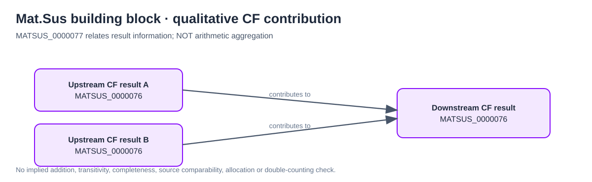

# Building block: Qualitative upstream carbon-footprint contribution

**Scope:** Two CF result-information individuals are connected via Mat.Sus `contributes to (MATSUS_0000077)` to a downstream CF result-information individual. It is a relationship between represented assessment results.

- [Example ABox](shape-data.ttl)
- [SHACL data profile](shape.ttl)
- **Not supported by this relation:** arithmetic sum, transitive contribution, exhaustive system coverage, methodological comparability, allocation, units conversion or absence of double counting.
- **Reuse decision:** Use this building block for provenance only. Add a separate calculation/validation profile where numerical reproducibility is actually required.
