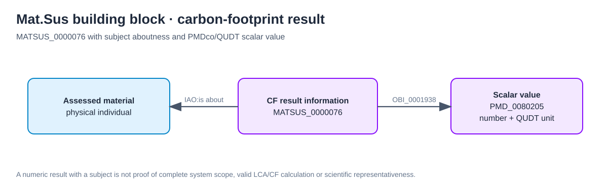

# Building block: Carbon-footprint result information

**Scope:** Minimal Mat.Sus CF result information about a material or product, represented with a PMDco/QUDT scalar quantity value. It **does not** model a computational method, an LCA process, a system boundary or a scientifically validated result.

- [Example ABox](shape-data.ttl)
- [SHACL data profile](shape.ttl)
- In the example, the unit IRI is a unit of mass. The CO₂-equivalent meaning comes from the CF result semantics and governing specification, **not** from interpreting the kilogram unit as intrinsically CO₂e.
- The lightweight SHACL profile checks the number/unit structure but does not load the QUDT unit taxonomy or validate mass dimensionality. Use an additional QUDT-aware profile when dimensional validation is required.
- The case-specific `MATSUS_0000068` used in P2 is **life cycle assessment specification**; it is not renamed or declared equivalent to a generic CF-computation specification here.
- **Reuse decision:** Add a separate governing-specification pattern only once its intended ontological class and scope are resolved.
