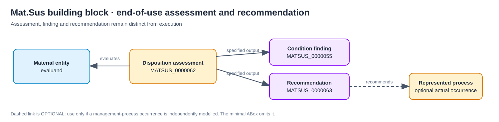

# Building block: End-of-use disposition assessment and recommendation

**Scope:** A minimal Mat.Sus application profile for evaluating a material entity, recording a finding and issuing a recommendation. Unlike integrated P1, this block has no disassembly or executed recycling.

The assessment `MATSUS_0000062` `evaluates (MATSUS_0000060)` the component and has specified output (`OBI_0000299`) of result information. The recommendation `MATSUS_0000063` can use `recommends (MATSUS_0000064)` when a genuine management-process occurrence is separately represented. The minimal example omits the link and deliberately **does not invent an unexecuted process individual** merely from an intended pathway.

- [Example ABox](shape-data.ttl)
- [SHACL data profile](shape.ttl)
- **Reuse:** This shape defines a *complete record profile*, not universal OWL necessities. As a data-profile decision, it requires explicit `evaluates` even though equivalent OWL entailments need not be explicitly asserted in every dataset.
- **Modelling decision:** A recommendation does not equal authorization or execution. Do not create a BFO process occurrence merely to represent a possible, unexecuted pathway; use suitable information representations instead. Avoid a global SHACL requirement for `recommends` when no process occurrence is justified.
