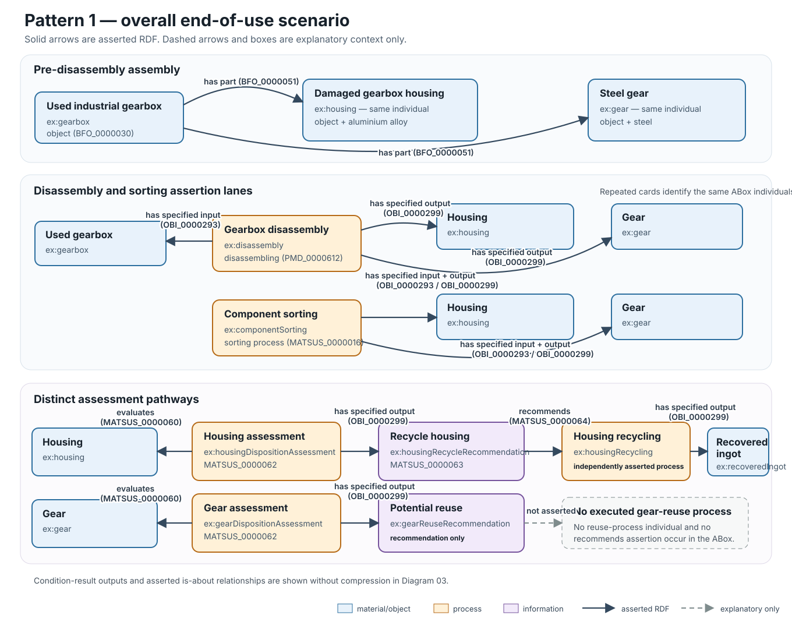
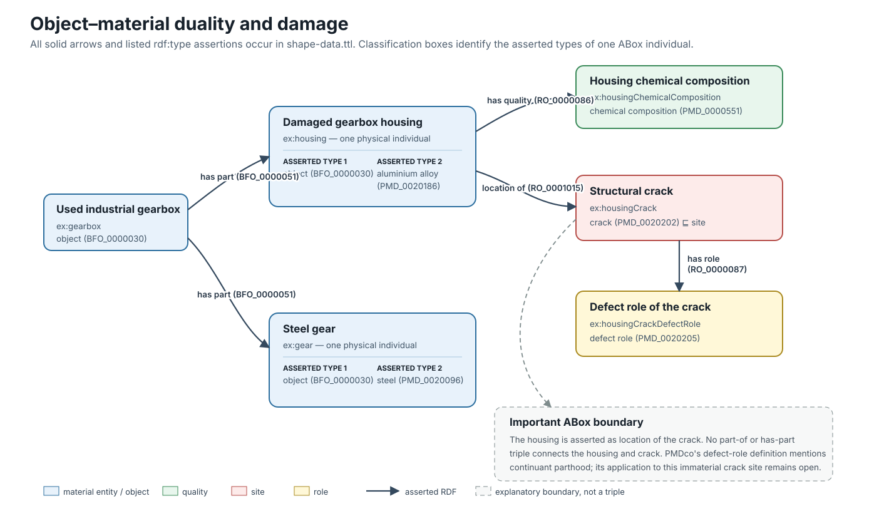
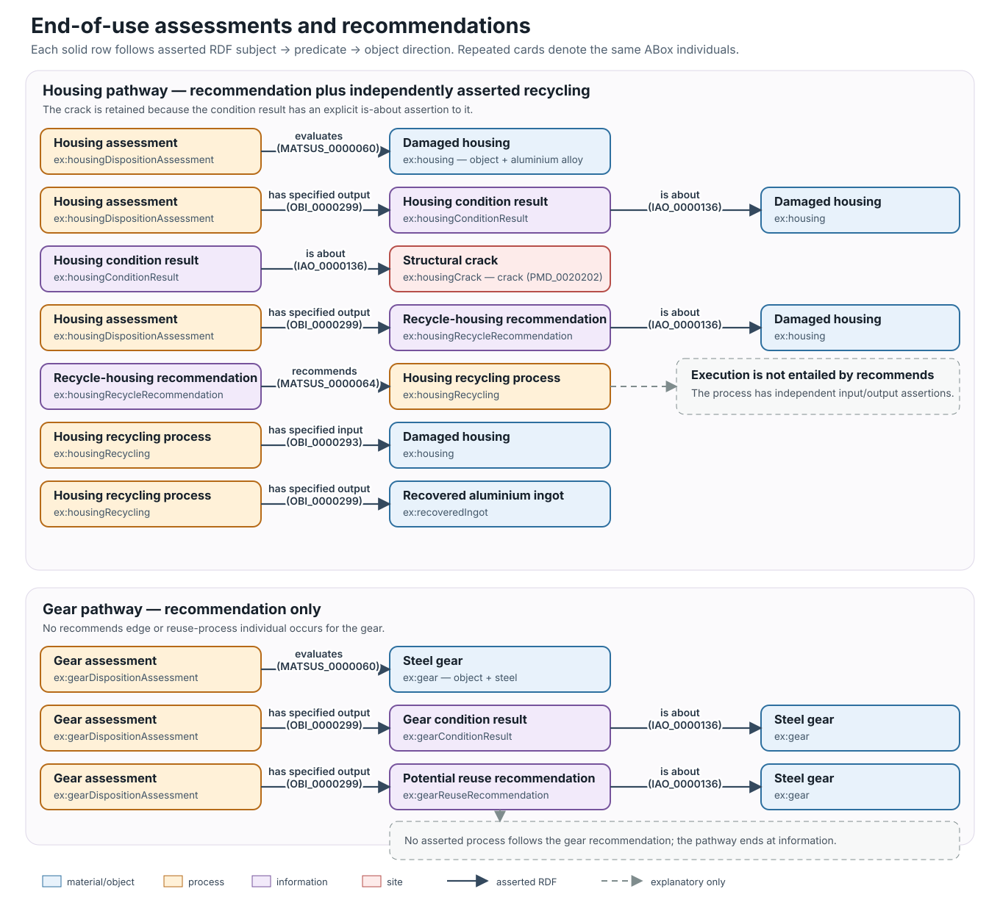
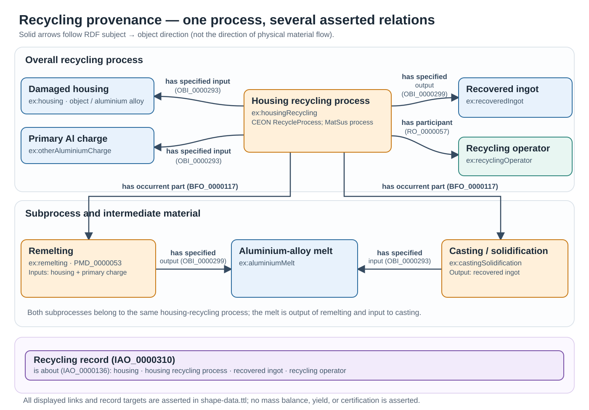

# Pattern: Component End-of-Use Assessment and Recycling Provenance

## Purpose

This pattern uses a synthetic gearbox example to connect **end-of-use assessment**, **component recycling**, and **qualitative material provenance**. It also illustrates how a component can be modelled as both an object and a material without introducing separate physical individuals.

## 1. Overall scenario

A used gearbox is disassembled. The example models the separated housing and steel gear as members of one **disassembled-component aggregate** (`object aggregate`, `BFO_0000027`). The disassembly process has the aggregate **and both components** as specified outputs. The aggregate `has part (BFO_0000051)` the original housing and gear individuals; it is not a second gearbox or a replacement for either component.

The asserted **component sorting process** takes this aggregate as a specified input and has the **same housing and gear individuals** as specified outputs, representing their organization into separate streams without creating duplicate physical objects. Sorting is included as an executed process in this example, but it is **optional when adapting the pattern**. The housing and gear are evaluated by separate end-of-use disposition assessments, which recommend recycling and potential reuse, respectively. Only housing recycling is represented as executed.

*Reading the figure: coloured boxes represent individuals (smaller text gives their asserted types). Solid arrowheads always follow RDF **subject → object**, not necessarily physical material flow. Dashed annotations are explanatory, not asserted RDF relationships. The disassembly–sorting–assessment sequence is illustrative; the example does not assert an explicit temporal ordering relation. The gearbox `has part` statements describe the initial assembly; the aggregate's membership describes the separated components. Neither relation is time-qualified in the ABox.*

## 2. Object–material duality and damage

The **same housing individual** is typed as both `object (BFO_0000030)` and `aluminium alloy (PMD_0020186)`; the gear likewise has object and steel types. This follows the [PMDco object–material duality pattern](https://github.com/materialdigital/core-ontology/tree/main/patterns/duality%20object%20material). The housing also has a chemical-composition quality and is the location of a crack site bearing a defect role.

## 3. End-of-use assessments and recommendations

Each component is evaluated in a separate **end-of-use disposition assessment**, which outputs a condition result and a recommendation. The housing recommendation identifies a recycling process that is also independently modelled as executed. The gear's potential-reuse recommendation does **not** identify an executed reuse process.

## 4. Recycling provenance

The housing and additional **primary aluminium raw material** are inputs to recycling. The model records remelting, an intermediate melt, casting/solidification and a recovered aluminium-alloy ingot. A recycling document is explicitly *about* the housing, recycling process, ingot and operator.

The input–output links establish **qualitative provenance**, not a mass balance, recycled-content percentage, verified alloy grade or certified chain of custody. The additional charge is typed as **primary raw material**; a **virgin material** classification is not asserted.

## Appendix — example, reuse and validation

- **Example ABox:** [`shape-data.ttl`](shape-data.ttl) — 98 asserted triples in a synthetic scenario; component identity is preserved across disassembly, sorting and assessment.
- **Executable checks:** [eight competency questions and two structural checks](validation/queries/); [runner](validation/run_queries.py) and [expected answers](validation/expected_rows.json). From this directory run `python validation/run_queries.py`.
- **Evidence:** The original 94-triple example was accepted in evaluation rounds R1–R3. **For this 98-triple revision, all ten asserted-RDF checks passed locally using RDFLib 7.5.0. Fresh import-closure resolution and ROBOT/HermiT consistency and coherence checks also passed against pinned PMDco v3.1.2.** P1-specific SHACL conformance has not been run; the ten queries are not part of standard repository CI.
- **Semantic boundary:** PMDco's crack-site/defect-role parthood interpretation remains unresolved. No crack–housing parthood edge is asserted. Recommendations do not themselves imply execution. No explicit temporal interval or sequence assertion is included.

### Key predicates for adaptation

| Predicate | Use in this pattern |
| --- | --- |
| `evaluates (MATSUS_0000060)` | Link an end-of-use assessment to the component being evaluated. |
| `has specified input / output (OBI_0000293 / OBI_0000299)` | Identify process inputs and outputs. |
| `has part (BFO_0000051)` | Link the disassembled-component object aggregate to the original component objects. |
| `recommends (MATSUS_0000064)` | Link a recommendation to a proposed management process, without asserting execution. |
| `has occurrent part (BFO_0000117)` | Identify the recycling subprocesses. |
| `is about (IAO_0000136)` | Connect result or record information to its subject matter. |
