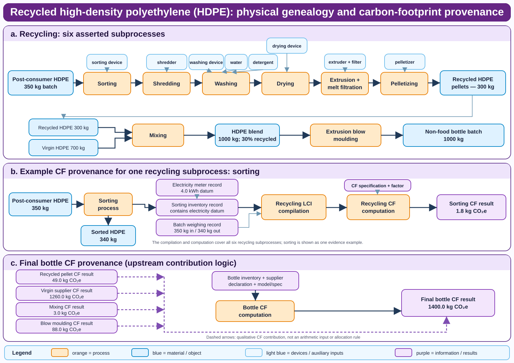
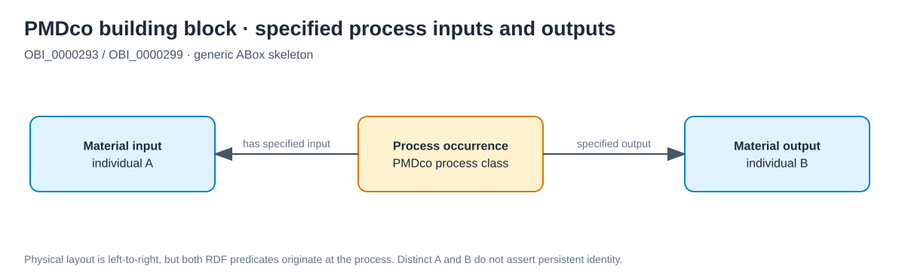
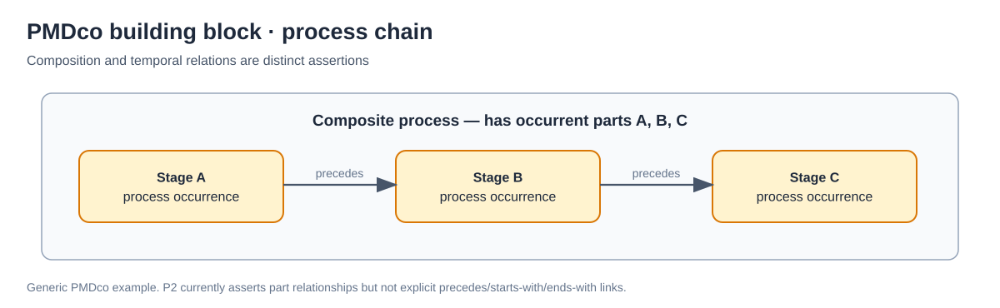
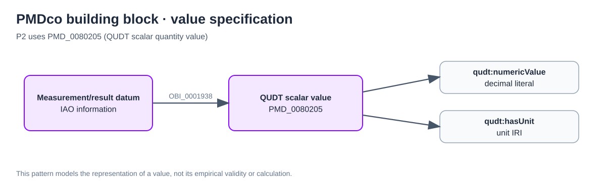
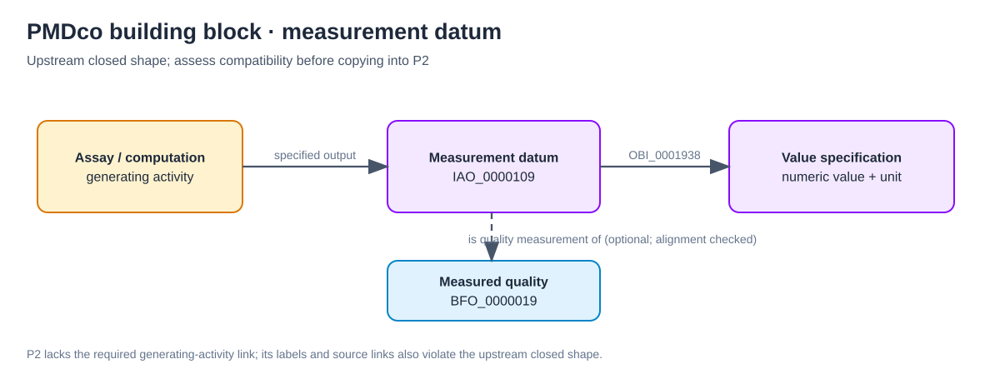
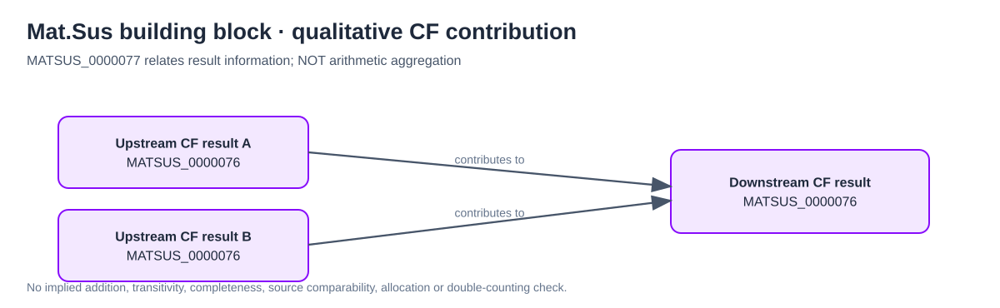

# Pattern: Recycled Polymer Processing and Carbon-Footprint Provenance

## Purpose and scope

**Role:** P2 is an **integrated application-level modelling demonstration**, not a minimal, directly reusable ontology building block. Its purpose is to show how existing PMDco patterns and Mat.Sus sustainability concepts can be composed in one traceable materials-processing scenario. Building blocks should be consulted and adapted independently, not copied wholesale from this application story.

This synthetic HDPE bottle-to-bottle scenario connects distinct physical batches and executed recycling processes, sourced process-inventory data, LCI compilation, black-box CF computations and results, supplier-provided CF information, and downstream product provenance. It illustrates the difference between physical flows, observed data, specifications, computational activities and reported results.

**Evidence boundary:** This is an interoperability and provenance demonstration, **not** a validated carbon-footprint calculator, certified mass balance, full LCA, PEF-compliant study, verified supplier assessment or empirical industrial dataset. All quantities, records and results are synthetic. RDF, SHACL, SPARQL or reasoner success does not establish scientific or numerical correctness.



The combined diagram has three panels:

- **a. Recycling:** the six asserted recycling subprocesses, material batches, mixing and bottle production.
- **b. Sorting CF provenance:** an exemplary provenance view for sorting, including sourced electricity consumption, the sorting inventory and batch-mass evidence.
- **c. Final bottle CF provenance:** the upstream CF results, supplier declaration, computing activity and final bottle CF result are shown as distinct elements.

Essential interpretation limits for the diagram are:

- Device labels provide illustrative context; they do not denote additional asserted equipment individuals.
- Intermediate material batches are visually summarized; the RDF retains the full material genealogy. The integrated extrusion-and-melt-filtration box represents one top-level operation with distinct extrusion and melt-filtration constituent occurrences.
- Sorting is the exemplary CF-provenance visualization. Washing remains the detailed multi-input inventory example in the RDF and discussion below, while the recycling LCI compilation and CF computation cover all six subprocesses.
- The supplier CF declaration and supplier CF result are distinct information entities.
- Qualitative `contributes to` relations do not assert arithmetic summation, direct computation inputs or validated allocation.

## Reusable modelling building blocks illustrated by P2

The following are **small explanatory sketches**, not additional asserted ABox nodes or TBox classes. The PMDco sketches reference patterns already available in the [PMDco patterns library](https://github.com/materialdigital/core-ontology/tree/main/patterns). They reproduce the modelling choices relevant to this case; they do not assert that P2 is an exact instantiation of every upstream SHACL constraint. The Mat.Sus sketches illustrate sustainability-specific composition candidates. Inspect the RDF and pinned imports before reusing them.

### PMDco building blocks (reused concepts)

**Process input/output** — material individuals are specified inputs/outputs of process occurrences. This is asserted in P2; the directed RDF properties originate at the process.

At the six top-level recycling occurrences this pattern is present. The nested `extrusion` and `meltFiltration` constituents intentionally have no asserted inputs or outputs because the example provides no evidence for a defensible intermediate stream or for projecting the integrated operation's complete boundary onto either constituent. Consequently, under the pinned type closure the `PMD_0200004` extrusion constituent does **not** conform to PMDco's manufacturing-process input/output SHACL, which requires at least one specified input and output. This is an explicit compatibility boundary: resolve the constituent process boundaries from evidence before reusing that upstream profile; do not add duplicate or invented flow assertions merely to obtain conformance.



**Process chain** — `has occurrent part` represents decomposition, while `precedes`, `starts with` and `ends with` represent additional temporal claims. **P2 currently asserts six top-level occurrent parts, two constituent occurrences within the integrated extrusion-and-melt-filtration operation, and specified input/output links, but no temporal ordering.** Before adding ordering, determine whether the full subprocess occurrences really do not overlap, particularly in production-line operation. Do not infer strict `precedes` merely from material-flow genealogy.



**QUDT scalar value specification** — P2 already uses `PMD_0080205` with `qudt:numericValue` and `qudt:hasUnit` to represent values. This models a number/unit pair, not the derivation or validity of the number. Whether the unit IRI has the expected `qudt:Unit` type depends on available unit vocabulary; see the SHACL profile notes.



**Measurement datum** — P2 types sourced electricity/mass data as `IAO_0000109` with a numeric value and source record, but it does **not** satisfy PMDco's current closed measurement-datum SHACL. In particular, most P2 data have no `is specified output of (OBI_0000312)` link, and their `rdfs:label` and `dcterms:source` predicates are not allowed by that closed upstream shape. The PMDco shape checks measured-quality/value-target alignment when those optional links are present; it does not currently require a measured-quality link. This is an **open alignment issue**, not a validated equivalence between the profiles. Do not invent an assay or quality merely to satisfy the upstream shape; resolve the intended evidence semantics first.



### Mat.Sus-specific building blocks (candidates and reusable examples)

**Unresolved specification issue** — P2 currently links records typed as `MATSUS_0000068`, computing processes, and CF results. Because `MATSUS_0000068` is formally a **life cycle assessment specification** while P2 explicitly does not claim a complete LCA, this composition is not published here as a reusable building block. Human review should either justify the LCA-specification typing for these scoped calculations or introduce a correctly scoped specification class before extracting a generic pattern.

**Qualitative upstream CF contribution** — `MATSUS_0000077` connects assessment-result information; it does not prove numerical aggregation, allocation, exhaustive coverage or methodological comparability.



Minimal Mat.Sus reuse candidates are documented separately in [CF result provenance](../bb-cf-result-provenance/pattern.md) and [qualitative CF contribution](../bb-cf-contribution/pattern.md). They remain independent of the full HDPE scenario.

### SHACL profile for the integrated demonstration

[Application-level SHACL shapes](shape.ttl) document **selected complete-record requirements** for this story (sourced measurement values, records currently typed as LCA specifications, computations, CF results and contribution links). They are examples of *how to define scoped constraints*, not universal rules for every possible PMDco/Mat.Sus dataset and not approval of `MATSUS_0000068` as a generic CF-computation specification. They do not validate chronological claims, material identity, quantitative mass balance, numerical CF derivation, scientific validity or supplier comparability.

Use them alongside competency questions. SHACL validation against the exact current asserted RDF and separately against the pinned import closure, with positive/negative tests, is a required verification step before release. The upstream PMDco measurement-datum shape is **not yet established as compatible** with the P2 data representation.

## Physical material and process model

The one `mechanicalRecycling` occurrence has six actual top-level occurrent parts through `has occurrent part (BFO_0000117)`: sorting, shredding, washing, drying, an integrated extrusion-and-melt-filtration operation, and pelletizing. The integrated operation in turn has distinct `extrusion` and `meltFiltration` constituent occurrences. Chronology is shown only by the six top-level occurrences' `has specified input/output (OBI_0000293/OBI_0000299)` links. No subclass assertion represents a stage, sequence, or part, and no unsupported intermediate stream or allocation is introduced between the two constituents.

Successive batches are distinct physical individuals: 350 kg post-consumer packaging, 340 kg sorted stream, 335 kg flake, 320 kg washed flake, 315 kg dried flake, 310 kg filtered extrudate, and 300 kg recovered pellets. The graph records qualitative transformation genealogy without pretending that one physical individual persists unchanged. The quantities resemble a mass ledger but are not a certified balance; losses and their destinations are not modelled.

The batch pattern uses `high-density polyethylene (PMD_0050007)` plus `disconnected material entity aggregate (PMD_0000891)`. The recovered batch is also `recycled material (MATSUS_0000002)` and `secondary material (MATSUS_0000003)`. The incoming post-consumer batch is not asserted as a Mat.Sus waste material: the pinned waste-role model has constraints requiring a separate temporal/contextual treatment not justified here.

| Occurrence | Asserted type | Decision |
| --- | --- | --- |
| sorting | `MATSUS_0000016` sorting process | Exact Mat.Sus process class. |
| shredding | `MATSUS_0000093` shredding process | Exact local process class under PMDco dividing. |
| washing | `OBI_0302888` washing | Exact OBI class for contaminant removal through cycles of solution in flow; the asserted water, detergent and wastewater context is compatible. |
| drying | `MATSUS_0000095` drying process | Exact materials-oriented local process class under OBI material component separation. |
| integrated extrusion + melt filtration | `PMD_0000833` manufacturing process | Broad type for the integrated occurrence that retains the existing inventory and CF provenance. |
| extrusion constituent | `PMD_0200004` extrusion | Exact PMDco class; a distinct occurrent part of the integrated operation. |
| melt-filtration constituent | `MATSUS_0000094` melt filtration process | Exact generic local class under OBI filtration; a distinct occurrent part of the integrated operation. |
| pelletizing | `MATSUS_0000096` pelletizing process | Exact generic local process class under PMDco manufacturing process. |
| mixing | `PMD_0000778` mixing | Exact process class. |
| extrusion blow molding | `PMD_0200007` blow molding | Definition gives HDPE bottle extrusion blow molding as an example. |

Four primitive Mat.Sus classes close the verified vocabulary gaps without equivalence mappings or method-specific restrictions. Regranulation remains distinct and is not used as a synonym or Pattern occurrence.

## Inventory and characterization evidence

Every recycling subprocess has an inventory document about that occurrence, at least one electricity-consumption measurement datum, a QUDT-backed scalar value, and a named synthetic source record. Washing is the worked example: physical HDPE flake, water and detergent inputs and washed flake and wastewater outputs are distinct from the information records about them. Its inventory records 18 kWh electricity, 450 L water, 1.5 kg detergent, and 430 L wastewater. These are synthetic test values.

`recyclingLCIAnalysis` is a `life cycle inventory analysis process (MATSUS_0000066)`. It compiles the six unit-process records and batch weighing record into a separate `compiledRecyclingInventory` document. Inventory data remain distinct from CF results.

The PP example uses `chemical composition analyzing process (PMD_0000552)`, an explicit non-validated plan specification, the recovered pellet batch as evaluand, and a measurement datum about a local material individual typed as `polypropylene (PMD_0050009)`, a `mass fraction (PMD_0020102)` quality, and a dry-mass basis specification. This avoids using the PMDco polypropylene class itself as an `IAO:is about` individual target. The illustrative result is 0.8 %. The constituent individual does not assert a validated identification method, physical parthood, or a laboratory claim.

## Carbon-footprint provenance pattern

Each CF result is `MATSUS_0000076`, is about its assessed material/product/process subject, `climate change (MATSUS_0000078)` and `GWP100 (MATSUS_0000079)`, and has a QUDT scalar value. The value is typed as `qudt scalar quantity value (PMD_0080205)`, whose pinned equivalence combines the OBI scalar-value and QUDT quantity-value patterns and requires `qudt:hasUnit`; the graph also provides a literal `qudt:numericValue`. The numeric result unit is kilogram, while CO2-equivalent meaning is supplied jointly by the CF-result type, climate-change/GWP100 targets and governing specification rather than by asserting that kilogram itself means CO2e.

Each result is the specified output of an identifiable `computing process (PMD_0000583)` taking the applicable `system model (MATSUS_0000072)`, CF specification and evidence as inputs. This choice follows the pinned definition of a process that performs computational analyses or transformations and does **not** equate the computation with `life cycle assessment process (MATSUS_0000065)`. The latter denotes a substantive sustainability assessment with LCI and LCIA parts. `recyclingLCIAnalysis` and `bottleLCIAnalysis` remain separately typed as `MATSUS_0000066`. Their compiled-inventory outputs are specified inputs to the corresponding computations; no process-parthood relation is asserted because no instance evidence establishes the LCI activities as temporal parts of those computations. Each CF specification contains functional-unit, reference-flow and system-boundary specifications (`MATSUS_0000069/70/71`). Computations remain black-box.

The synthetic recycling result set is 1.8, 5.2, 9.4, 10.1, 19.8 and 2.7 kg CO2e for the six subprocesses and 49.0 kg CO2e for the 300 kg recovered-pellet batch. The subprocess values arithmetically total 49.0 in this illustrative dataset. Unit-process results `contribute to (MATSUS_0000077)` the pellet result, but that relation itself does not assert summation or supply a reproducible calculation method, completeness demonstration or allocation method.

The virgin 700 kg HDPE batch has its own supplier system model, cradle-to-bottle-plant-gate specification, black-box computation and 1260.0 kg CO2e result. Only the supplier computation has that result as specified output. A separate declaration document is about the supplier, batch, supplier computation, result and specification and cites the same synthetic primary-data record used by the supplier computation. The bottle computation consumes this declaration as evidence; it does not produce the supplier result. This distinguishes a declaration from the calculated result it communicates; independent verification and comparability are not asserted.

The entire 300 kg recycled-pellet batch and independent 700 kg virgin batch enter mixing, producing a 1000 kg blend and an illustrative `recycled content datum (MATSUS_0000081)` of 30 % by mass. Blow molding produces the 1000 kg bottle batch. The final black-box result is 1400.0 kg CO2e; recycled-pellet (49.0), supplier (1260.0), mixing (3.0) and blow-molding (88.0) results qualitatively contribute. The illustrative arithmetic is `49.0 + 1260.0 + 3.0 + 88.0 = 1400.0 kg CO2e`. This numerical agreement does not establish methodological comparability, complete system boundaries, valid allocation, exhaustive coverage, absence of double counting or PEF compliance. `MATSUS_0000077` itself establishes neither arithmetic addition, allocation, transitivity nor comparability.

A synthetic electricity factor (0.4 kg CO2e/kWh) has a named synthetic source, a factor-basis specification about climate change and GWP100, a literal scalar and the QUDT unit `KiloGM-PER-KiloW-HR`. It is not an empirical database value and carries no geography, time, technology or representativeness claim. The [EU PEF Circular Footprint Formula in Commission Recommendation (EU) 2021/2279](http://data.europa.eu/eli/reco/2021/2279/oj) is only a candidate plan specification. No CFF parameters, allocation calculation, PEFCR, or compliance assertion is present.

## Ontology sources and evidence boundary

The Phase 2 vocabulary integration starts from repository revision `35ea2c47bb557b0d27102c40bc18fa5604c29e68` and was checked against:

- authoritative Mat.Sus development sources (`matsus-edit.owl`, `matsus.ttl`), version IRI `https://w3id.org/pmd/matsus/dev/`, source version info `2026-09-23`;
- pinned PMDco 3.1.2 (`https://w3id.org/pmd/co/3.1.2`, created 2026-10-21);
- pinned OBI v2026-07-27 (`http://purl.obolibrary.org/obo/obi/2026-07-27/obi.owl`) through the generated selected-term module for filtration and washing;
- FoodOn drying `FOODON_03000614` and FoodOn version IRI `http://purl.obolibrary.org/obo/foodon/releases/2026-09-20/foodon.owl` as conceptual inspiration only, without import, equivalence or mapping;
- Mat.Sus CEON integration of CEON v1.0.0 / process source 0.5;
- the Mat.Sus LOG Stage A component for the supplier class;
- completed Pattern 1 conventions in `patterns/component-end-of-use-provenance/`;
- official Commission Recommendation (EU) 2021/2279 for the CFF candidate.

The MKB3 reports named in the task were **not consulted**, because institutional authorization to disclose them to the configured Codex service was not established. This version therefore relies on authorized repository sources and the official public EU source; AutoMatCE-specific compatibility and report-level scientific findings remain an evidence limitation.

## Known limitations

- Regranulation is not represented as a synonym, class or occurrence because its process boundary remains unresolved.
- Batch identity uses physical aggregate/material typing and labels; no new batch class or full lot ontology is introduced.
- The post-consumer input's waste-role acquisition/loss interval is not represented.
- Times, explicit ordering, transport, collection, rejects, detailed emissions, uncertainty, data quality, allocation parameters and final-bottle end of life are outside scope.
- All values, records, supplier, methods and organizations are synthetic. PP contamination is not a validated result.
- Supplier and recycling scopes are documented but not proven methodologically comparable. Contribution edges are qualitative; arithmetic agreement of the synthetic values does not establish compatible or complete system boundaries, valid allocation or PEF compliance.
- Equations, allocation choices, completeness reconciliation, uncertainty and reproducible aggregate-result derivations are not disclosed; the computing-process occurrences are not asserted to be complete LCAs.
- QUDT unit IRIs are direct references; the local term audit covers selected Mat.Sus/PMDco/CEON/LOG terms, not a downloaded QUDT closure.

## Reproducible validation

From this pattern directory:

```powershell
python -m pip install "rdflib==7.5.0" "pyshacl>=0.30,<1"
python validation/run_queries.py
python -m pyshacl -s shape.ttl -i none -f human shape-data.ttl
```

The runner parses Turtle, executes seven competency questions and five structural checks, compares exact sorted rows with `validation/expected_rows.json`, reports the asserted triple count, and audits 33 selected reused and local term identifiers against pinned repository sources. The CF check binds every expected result to its correct material/product/process subject, actual `PMD_0000583` computation, governing specification, functional unit, reference flow, boundary, literal number and unit. The inventory check requires a sourced electricity datum with a typed QUDT scalar, numeric literal and kWh unit for every recycling subprocess. The supplier traceability check requires the declaration-to-result/source/specification chain and use of that declaration by the bottle computation. The process-vocabulary checks require exact asserted types, top-level and nested containment, the four approved direct superclass axioms, the imported OBI hierarchy, absence of local equivalence axioms, and absence of a regranulation label synonym.

The asserted graph and the same graph with the committed Mat.Sus/pinned-import closure both conform to the local application profile. Positive examples and adversarial mutations were checked independently with pySHACL. The same P2 graph intentionally does **not** conform to PMDco's closed measurement-datum profile, its QUDT profile when the QUDT unit vocabulary is absent, or—under the pinned type closure—its manufacturing-process input/output profile for the boundary-free nested extrusion constituent. These are documented compatibility boundaries, not local-profile successes.

Seven deterministic query mutations remove, one at a time, the final-bottle result subject, its scalar number, its scalar unit, the washing-electricity source, the supplier declaration-to-CF-result `IAO:is about` assertion, the shredding exact type, and the nested melt-filtration parthood assertion. Each mutation must produce exactly the expected structural violation. Additional SHACL mutation tests exercise the local application profile independently. `CQ-P2-02` discovers the main intermediate-batch path by traversing specified-input/output edges between the composite feed and pellet output rather than enumerating every tuple with `VALUES`.

Optional repository-level reasoning, when ROBOT is available, should merge `shape-data.ttl` with the catalog-resolved authoritative Mat.Sus ontology and run the repository's established HermiT reasoning/coherence commands. Reasoner success still does not validate values, boundaries, allocation or scientific correctness.

The questions cover recycling composition; graph-traversed intermediate genealogy; washing inventory provenance; CF result/computation/reference/boundary/evidence; PP characterization; virgin/recycled bottle contributions; and source/limitation traceability.
