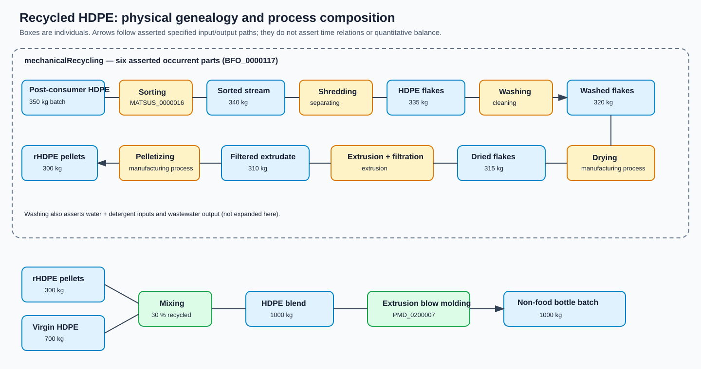
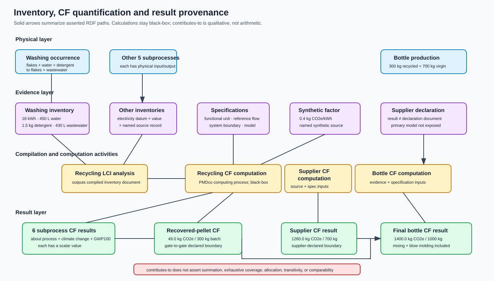

# Pattern: Recycled Polymer Processing and Carbon-Footprint Provenance

## Purpose and scope

This asserted-RDF pattern connects an executed polymer-recycling process, physical batch genealogy, unit-process inventory evidence, one material characterization, black-box carbon-footprint (CF) quantification, supplier-provided CF information, and downstream product CF traceability. The scenario is a wholly **synthetic HDPE bottle-to-bottle example** ending in non-food detergent/shampoo bottles.

It is an interoperability and provenance example, not a full LCA, mass-balance certification, industrial dataset, CF calculator, validated laboratory method, PEF study, product-category rule, or compliance claim. Numerical values exercise graph structure and queries only. Successful RDF, SPARQL, term-audit, or reasoner checks do not establish scientific correctness.



## Physical material and process model

The one `mechanicalRecycling` occurrence has six actual occurrent parts through `has occurrent part (BFO_0000117)`: sorting, shredding, washing, drying, extrusion with integrated melt filtration, and pelletizing/regranulation. Chronology is shown only by each occurrence's `has specified input/output (OBI_0000293/OBI_0000299)` links. No subclass assertion represents a stage, sequence, or part.

Successive batches are distinct physical individuals: 350 kg post-consumer packaging, 340 kg sorted stream, 335 kg flake, 320 kg washed flake, 315 kg dried flake, 310 kg filtered extrudate, and 300 kg recovered pellets. The graph records qualitative transformation genealogy without pretending that one physical individual persists unchanged. The quantities resemble a mass ledger but are not a certified balance; losses and their destinations are not modelled.

The batch pattern uses `high-density polyethylene (PMD_0050007)` plus `disconnected material entity aggregate (PMD_0000891)`. The recovered batch is also `recycled material (MATSUS_0000002)` and `secondary material (MATSUS_0000003)`. The incoming post-consumer batch is not asserted as a Mat.Sus waste material: the pinned waste-role model has constraints requiring a separate temporal/contextual treatment not justified here.

| Occurrence | Asserted type | Decision |
| --- | --- | --- |
| sorting | `MATSUS_0000016` sorting process | Exact Mat.Sus process class. |
| shredding | `PMD_0000927` separating | No exact pinned shredding class; least-committal verified superclass. |
| washing | `PMD_0000560` cleaning | Definition explicitly includes washing. |
| drying | `PMD_0000833` manufacturing process | No exact pinned polymer-drying class. |
| extrusion + melt filtration | `PMD_0200004` extrusion | Exact extrusion class; integrated filtration remains an evidence gap. |
| pelletizing | `PMD_0000833` manufacturing process | No exact pinned pelletizing/regranulation class. |
| mixing | `PMD_0000778` mixing | Exact process class. |
| extrusion blow molding | `PMD_0200007` blow molding | Definition gives HDPE bottle extrusion blow molding as an example. |

No local TBox class or property is introduced. The four process-coverage gaps are information individuals in `knownLimitationsRecord`, not invented classes.

## Inventory and characterization evidence

Every recycling subprocess has an inventory document about that occurrence, at least one electricity-consumption measurement datum, a QUDT-backed scalar value, and a named synthetic source record. Washing is the worked example: physical HDPE flake, water and detergent inputs and washed flake and wastewater outputs are distinct from the information records about them. Its inventory records 18 kWh electricity, 450 L water, 1.5 kg detergent, and 430 L wastewater. These are synthetic test values.

`recyclingLCIAnalysis` is a `life cycle inventory analysis process (MATSUS_0000066)`. It compiles the six unit-process records and batch weighing record into a separate `compiledRecyclingInventory` document. Inventory data remain distinct from CF results.

The PP example uses `chemical composition analyzing process (PMD_0000552)`, an explicit non-validated plan specification, the recovered pellet batch as evaluand, and a measurement datum about a local material individual typed as `polypropylene (PMD_0050009)`, a `mass fraction (PMD_0020102)` quality, and a dry-mass basis specification. This avoids using the PMDco polypropylene class itself as an `IAO:is about` individual target. The illustrative result is 0.8 %. The constituent individual does not assert a validated identification method, physical parthood, or a laboratory claim.

## Carbon-footprint provenance pattern



Each CF result is `MATSUS_0000076`, is about its assessed material/product/process subject, `climate change (MATSUS_0000078)` and `GWP100 (MATSUS_0000079)`, and has a QUDT scalar value. The value is typed as `qudt scalar quantity value (PMD_0080205)`, whose pinned equivalence combines the OBI scalar-value and QUDT quantity-value patterns and requires `qudt:hasUnit`; the graph also provides a literal `qudt:numericValue`. The numeric result unit is kilogram, while CO2-equivalent meaning is supplied jointly by the CF-result type, climate-change/GWP100 targets and governing specification rather than by asserting that kilogram itself means CO2e.

Each result is the specified output of an identifiable `computing process (PMD_0000583)` taking the applicable `system model (MATSUS_0000072)`, CF specification and evidence as inputs. This choice follows the pinned definition of a process that performs computational analyses or transformations and does **not** equate the computation with `life cycle assessment process (MATSUS_0000065)`. The latter denotes a substantive sustainability assessment with LCI and LCIA parts. `recyclingLCIAnalysis` and `bottleLCIAnalysis` remain separately typed as `MATSUS_0000066`. Their compiled-inventory outputs are specified inputs to the corresponding computations; no process-parthood relation is asserted because no instance evidence establishes the LCI activities as temporal parts of those computations. Each CF specification contains functional-unit, reference-flow and system-boundary specifications (`MATSUS_0000069/70/71`). Computations remain black-box.

The synthetic recycling result set is 1.8, 5.2, 9.4, 10.1, 19.8 and 2.7 kg CO2e for the six subprocesses and 49.0 kg CO2e for the 300 kg recovered-pellet batch. The subprocess values arithmetically total 49.0 in this illustrative dataset. Unit-process results `contribute to (MATSUS_0000077)` the pellet result, but that relation itself does not assert summation or supply a reproducible calculation method, completeness demonstration or allocation method.

The virgin 700 kg HDPE batch has its own supplier system model, cradle-to-bottle-plant-gate specification, black-box computation and 1260.0 kg CO2e result. Only the supplier computation has that result as specified output. A separate declaration document is about the supplier, batch, supplier computation, result and specification and cites the same synthetic primary-data record used by the supplier computation. The bottle computation consumes this declaration as evidence; it does not produce the supplier result. This distinguishes a declaration from the calculated result it communicates; independent verification and comparability are not asserted.

The entire 300 kg recycled-pellet batch and independent 700 kg virgin batch enter mixing, producing a 1000 kg blend and an illustrative `recycled content datum (MATSUS_0000081)` of 30 % by mass. Blow molding produces the 1000 kg bottle batch. The final black-box result is 1400.0 kg CO2e; recycled-pellet (49.0), supplier (1260.0), mixing (3.0) and blow-molding (88.0) results qualitatively contribute. The illustrative arithmetic is `49.0 + 1260.0 + 3.0 + 88.0 = 1400.0 kg CO2e`. This numerical agreement does not establish methodological comparability, complete system boundaries, valid allocation, exhaustive coverage, absence of double counting or PEF compliance. `MATSUS_0000077` itself establishes neither arithmetic addition, allocation, transitivity nor comparability.

A synthetic electricity factor (0.4 kg CO2e/kWh) has a named synthetic source, a factor-basis specification about climate change and GWP100, a literal scalar and the QUDT unit `KiloGM-PER-KiloW-HR`. It is not an empirical database value and carries no geography, time, technology or representativeness claim. The [EU PEF Circular Footprint Formula in Commission Recommendation (EU) 2021/2279](http://data.europa.eu/eli/reco/2021/2279/oj) is only a candidate plan specification. No CFF parameters, allocation calculation, PEFCR, or compliance assertion is present.

## Ontology sources and evidence boundary

Implementation used repository revision `b6b03fd21fbf1f7fcc8041da6264e5ed8f02bec4` and was checked against:

- authoritative Mat.Sus development sources (`matsus-edit.owl`, `matsus.ttl`), version IRI `https://w3id.org/pmd/matsus/dev/`, source version info `2026-09-23`;
- pinned PMDco 3.1.2 (`https://w3id.org/pmd/co/3.1.2`, created 2026-10-21);
- Mat.Sus CEON integration of CEON v1.0.0 / process source 0.5;
- the Mat.Sus LOG Stage A component for the supplier class;
- completed Pattern 1 conventions in `patterns/component-end-of-use-provenance/`;
- official Commission Recommendation (EU) 2021/2279 for the CFF candidate.

The MKB3 reports named in the task were **not consulted**, because institutional authorization to disclose them to the configured Codex service was not established. This version therefore relies on authorized repository sources and the official public EU source; AutoMatCE-specific compatibility and report-level scientific findings remain an evidence limitation.

## Known limitations

- Exact pinned classes are absent for shredding, polymer drying, melt filtration and pelletizing/regranulation.
- Batch identity uses physical aggregate/material typing and labels; no new batch class or full lot ontology is introduced.
- The post-consumer input's waste-role acquisition/loss interval is not represented.
- Times, explicit ordering, transport, collection, rejects, detailed emissions, uncertainty, data quality, allocation parameters and final-bottle end of life are outside scope.
- All values, records, supplier, methods and organizations are synthetic. PP contamination is not a validated result.
- Supplier and recycling scopes are documented but not proven methodologically comparable. Contribution edges are qualitative; arithmetic agreement of the synthetic values does not establish compatible or complete system boundaries, valid allocation or PEF compliance.
- Equations, allocation choices, completeness reconciliation, uncertainty and reproducible aggregate-result derivations are not disclosed; the computing-process occurrences are not asserted to be complete LCAs.
- QUDT unit IRIs are direct references; the local term audit covers selected Mat.Sus/PMDco/CEON/LOG terms, not a downloaded QUDT closure.

## Reproducible validation

From this pattern directory:

```powershell
python -m pip install "rdflib==7.5.0"
python validation/run_queries.py
```

The runner parses Turtle, executes seven competency questions and four structural checks, compares exact sorted rows with `validation/expected_rows.json`, reports the asserted triple count, and audits 27 selected reused term identifiers against pinned local sources. The CF check binds every expected result to its correct material/product/process subject, actual `PMD_0000583` computation, governing specification, functional unit, reference flow, boundary, literal number and unit. The inventory check requires a sourced electricity datum with a typed QUDT scalar, numeric literal and kWh unit for every recycling subprocess. The supplier traceability check requires the declaration-to-result/source/specification chain and use of that declaration by the bottle computation.

Five deterministic mutation tests remove, one at a time, the final-bottle result subject, its scalar number, its scalar unit, the washing-electricity source and the supplier declaration-to-CF-result `IAO:is about` assertion. Each mutation must produce exactly the expected structural violation. `CQ-P2-02` discovers the main intermediate-batch path by traversing specified-input/output edges between the composite feed and pellet output rather than enumerating every tuple with `VALUES`.

Optional repository-level reasoning, when ROBOT is available, should merge `shape-data.ttl` with the catalog-resolved authoritative Mat.Sus ontology and run the repository's established HermiT reasoning/coherence commands. Reasoner success still does not validate values, boundaries, allocation or scientific correctness.

The questions cover recycling composition; graph-traversed intermediate genealogy; washing inventory provenance; CF result/computation/reference/boundary/evidence; PP characterization; virgin/recycled bottle contributions; and source/limitation traceability.
